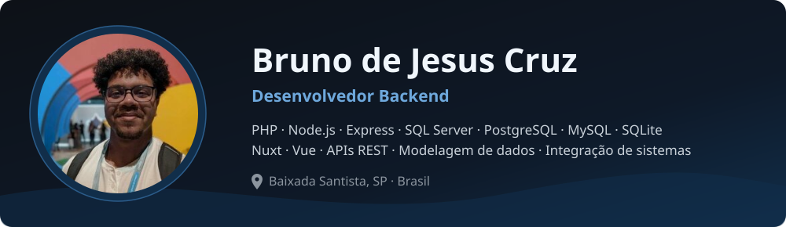

  
  

<picture>
  <source media="(prefers-color-scheme: dark)" srcset="https://raw.githubusercontent.com/BrunoJss/BrunoJss/output/cobrinha-escura.svg" />
  
</picture>

## Sobre

Sou formado em Análise e Desenvolvimento de Sistemas pela Universidade Metropolitana de Santos e desde 2023 trabalho com desenvolvimento e suporte na Viação Piracicabana & BR Mobilidade. Lá desenvolvo sistemas corporativos realizando desde o levantamento de requisitos à modelagem do banco em SQL Server e cuido da integração entre sistemas de fornecedores diferentes.

Em paralelo, desenvolvo sistemas para pequenos negócios e para o meu dia a dia, como a gestão financeira de um ateliê de costura, o portfólio de um filmmaker, uma loja virtual de streetwear e um app de lista de compras que funciona offline. São projetos que me tiram da zona de conforto e me fazem explorar tecnologias como Node.js, Nuxt, Redis e PostgreSQL.

## Projetos

<table>
  <tr>
    <td width="50%" valign="top">
      <h3><a href="https://memer.brunojss.com.br">Memer</a></h3>
      
Lista de compras da família em PWA: planejar, comprar, conferir e acompanhar os gastos por mês. Funciona sem internet e sincroniza as mudanças em lote quando a conexão volta, com autocomplete local e saldo calculado na hora.

      

        
        
        
        
      

    </td>
    <td width="50%" valign="top">
      <h3>Custodio</h3>
      
E-commerce de streetwear com loja em SSR e painel administrativo. Pagamento pelo PagBank com webhooks e log mascarado, cotação de frete no Melhor Envio, cupons, controle de produção, rotinas de backup e testes de integração num Postgres real.

      

        
        
        
        
      

    </td>
  </tr>
  <tr>
    <td width="50%" valign="top">
      <h3>Crisblac</h3>
      
Gestão financeira de um ateliê de lingerie, em uso diário pela dona. Controla compras, vendas, clientes e despesas, e calcula o custo de cada peça pelo preço dos materiais para sugerir o preço de venda.

      

        
        
        
      

    </td>
    <td width="50%" valign="top">
      <h3>Mobile Films</h3>
      
Portfólio de um filmmaker com painel próprio para publicar projetos, categorias e depoimentos. Vídeos e imagens ficam no Cloudflare R2, com SEO técnico e sitemap gerado a partir do banco.

      

        
        
        
      

    </td>
  </tr>
  <tr>
    <td width="50%" valign="top">
      <h3>NARDE</h3>
      
Sistema de horas complementares e de extensão da faculdade, que substituiu as planilhas. Perfis de coordenador, professor e aluno, cada um com suas regras.

      

        
        
      

    </td>
    <td width="50%" valign="top">
      <h3><a href="https://github.com/BrunoJss/placar">Placar</a></h3>
      
Placar de vôlei para o celular, feito para usar na quadra com a galera: toque para pontuar, trocar de lado e zerar o set.

      

        
        
      

    </td>
  </tr>
</table>

## Stack e ferramentas

   
   
  

## No GitHub

  
  

  

